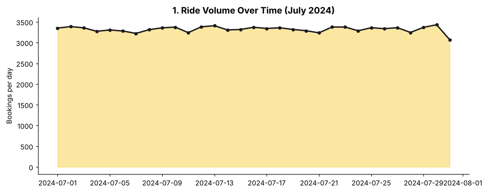
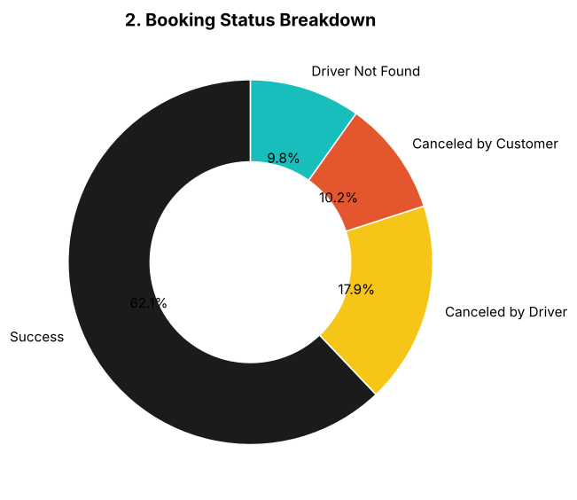
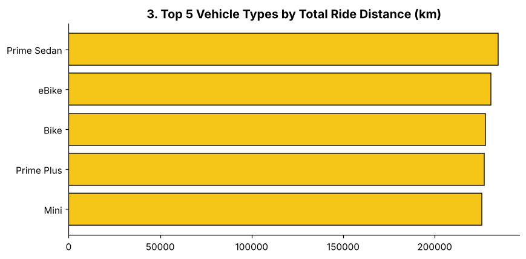
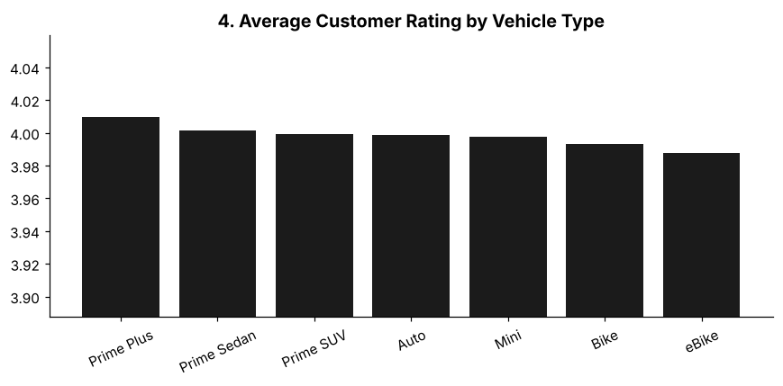
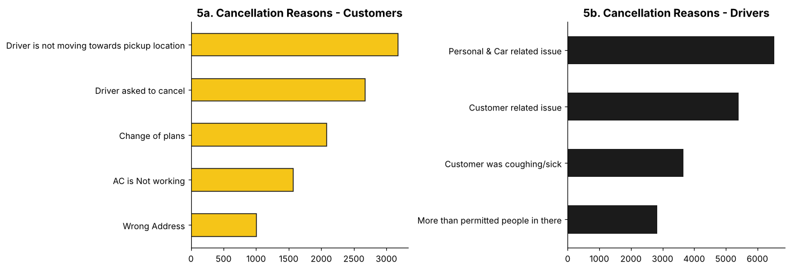
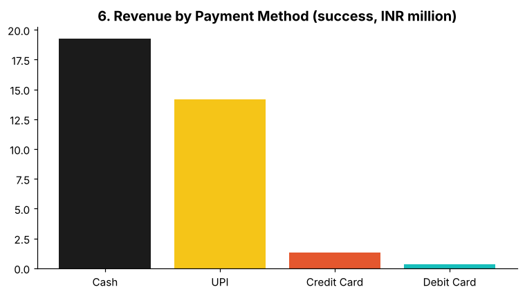
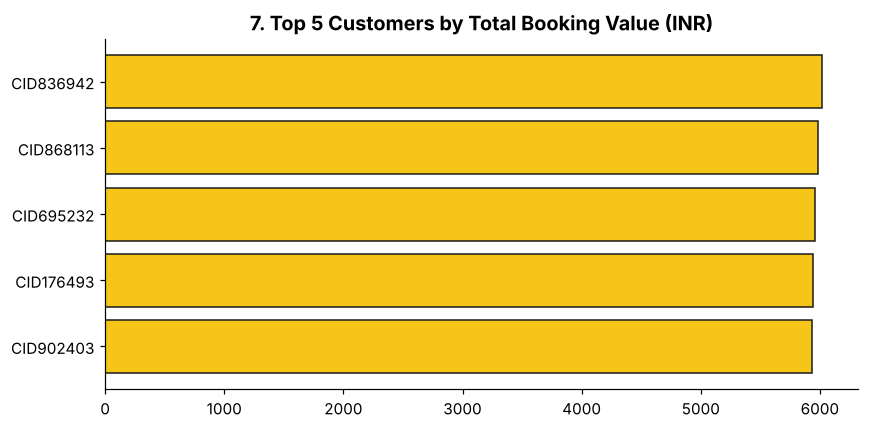
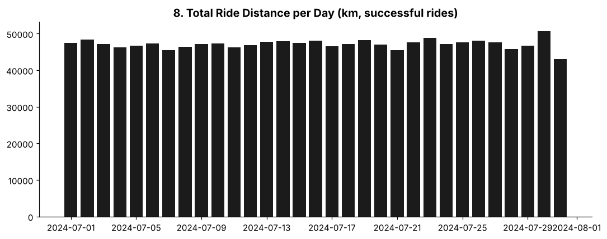
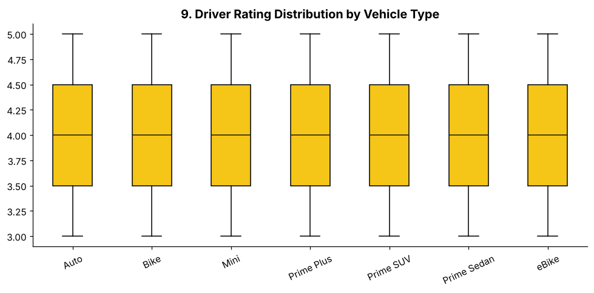
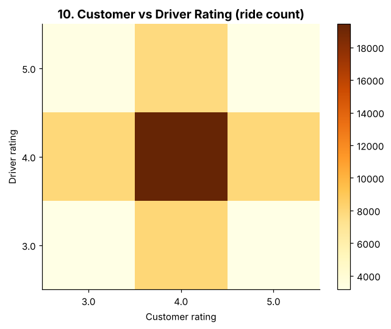

# 🚖 Ola Bengaluru Ride Analytics (SQL + Python + Power BI)

End-to-end data analyst project on one month (July 2024) of simulated **Ola** ride bookings in Bengaluru.
It answers the 10 SQL questions and 10 Power BI questions from the *Top Varsity* project brief, and adds a
Python analysis layer with reproducible charts.

> **Data note:** the dataset is synthetic (generated with ChatGPT per the brief), so patterns reflect the
> generation rules, not real Ola operations.

## 📁 Repository structure

```
ola-ride-analytics/
├── data/
│   ├── Bookings-100000-Rows.xlsx     # raw dataset
│   └── bookings.csv                  # cleaned CSV (generated by prepare_data.py)
├── sql/
│   ├── 01_create_database_and_table.sql
│   ├── 02_load_data.sql
│   └── 03_views_and_queries.sql      # the 10 SQL questions as views
├── python/
│   ├── prepare_data.py               # xlsx -> csv
│   └── analysis.py                   # KPIs + 10 charts -> images/
├── images/                           # generated charts
├── reports/
│   ├── Ola-Dashboard-Slides.pptx     # Power BI dashboard layout (5 views)
│   └── OLA-Data-Analyst-Project-Brief.pdf
├── requirements.txt
└── README.md
```

## 🗂️ Dataset

**103,024 rows × 19 columns**, 1–31 July 2024, 7 vehicle types, 50 Bengaluru pickup/drop areas.

| Column | Description |
|---|---|
| Date, Time | Booking timestamp |
| Booking_ID | Unique ID, `CNR` + 10 digits |
| Booking_Status | Success / Canceled by Customer / Canceled by Driver / Driver Not Found |
| Customer_ID | Customer identifier |
| Vehicle_Type | Auto, Bike, eBike, Mini, Prime Plus, Prime Sedan, Prime SUV |
| Pickup_Location, Drop_Location | Bengaluru areas |
| V_TAT, C_TAT | Vehicle / customer turnaround times (success only) |
| Canceled_Rides_by_Customer | Customer cancellation reason |
| Canceled_Rides_by_Driver | Driver cancellation reason |
| Incomplete_Rides, Incomplete_Rides_Reason | Yes/No and reason (success only) |
| Booking_Value | Fare in ₹ |
| Payment_Method | Cash, UPI, Credit Card, Debit Card (success only) |
| Ride_Distance | km (0 for non-success) |
| Driver_Ratings, Customer_Rating | Ratings (success only) |

## 🚀 How to run

```bash
pip install -r requirements.txt
python python/prepare_data.py     # creates data/bookings.csv
python python/analysis.py         # prints KPIs, writes charts to images/
```

**MySQL:** run the files in `sql/` in order (edit the CSV path in `02_load_data.sql` first).
**Power BI:** import `data/bookings.csv` (or the xlsx) and build the 5 views shown in
`reports/Ola-Dashboard-Slides.pptx`: Overall, Vehicle Type, Revenue, Cancellation, Ratings.

## 🧮 SQL questions

All 10 are in [`sql/03_views_and_queries.sql`](sql/03_views_and_queries.sql). Results on this dataset:

| # | Question | Result |
|---|---|---|
| 1 | Successful bookings | 63,967 rows |
| 2 | Avg ride distance per vehicle | ~25 km for all, **Auto ≈ 10 km** |
| 3 | Rides canceled by customers | 10,499 |
| 4 | Top customer by rides | CID954071 (5 rides) |
| 5 | Driver cancels: personal & car issues | 6,542 |
| 6 | Prime Sedan driver rating max / min | 5.0 / 3.0 |
| 7 | UPI rides | 25,881 |
| 8 | Avg customer rating per vehicle | ≈ 4.0 for all |
| 9 | Total successful booking value | ₹35,080,467 |
| 10 | Incomplete rides | 3,926 |

> Differences from the PDF's SQL: the data spells it **"Canceled"** (not "cancelled"), so filters use that;
> Q2 averages successful rides only (failed bookings have distance 0); `CREATE OR REPLACE VIEW` is used so
> scripts can be re-run.

## 📊 Power BI questions → charts

| | |
|---|---|
|  |  |
|  |  |
|  |  |
|  |  |
|  |  |

## 🔍 Key insights

- **Success rate 62.09%**, matching the 62% target. Failures: driver cancel 17.89%, customer cancel 10.19%, driver not found 9.83%.
- **Driver cancellations** are led by *Personal & Car related issue* (6,542), then *Customer related issue* (5,413).
- **Customer cancellations** are led by *Driver is not moving towards pickup* (3,175) and *Driver asked to cancel* (2,670), so driver-side behaviour drives most customer cancels.
- **Payments:** Cash 54.9% of successful revenue, UPI 40.4%, cards ~4.7%.
- **Total successful revenue ₹35.08M** of ₹56.53M booked (62%).
- **Autos** run much shorter rides (~10 km vs ~25 km) and cover the least distance.
- **Ratings:** averages ≈ 4.0 across all vehicle types, and customer vs driver ratings are uncorrelated (r ≈ 0).
- **Incomplete rides** are 3.81% of all bookings (under the 6% cap).

### ⚠️ Where the data differs from the brief
- Row count is 103,024, not 100,000.
- Customer cancellations are **10.19%**, above the brief's 7% cap (driver cancels 17.89% are within the 18% cap).
- The brief asked for more orders and higher value on weekends; the data shows **no weekend lift** (~3,294 bookings/day on weekends vs ~3,334 on weekdays; avg value ₹545 vs ₹550).
- Booking-value split is 70% < ₹500, 21% ₹500–1000, 9% > ₹1000 (brief: 70 / 28 / remainder).

## 🛠️ Tools
MySQL · Python (pandas, matplotlib) · Power BI · Excel

## 🙏 Credits
Project brief by [Top Varsity](https://www.youtube.com/@TopVarSity/videos). Dataset generated per the brief.
